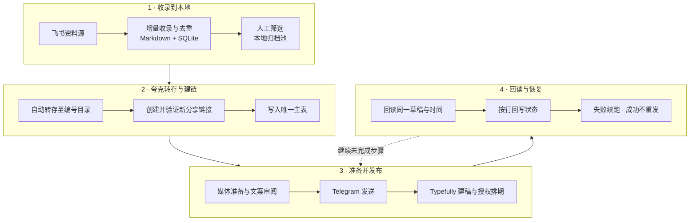

<div align="center">

# XPan Content Pipeline

### 从资料收录到自动发布，一条能追踪、能恢复的完整链路

**飞书收录 → 本地资料池 → 夸克转存 → 新分享链接 → 媒体与文案 → Telegram / X → 状态回写**

Python · SQLite · Excel · Quark · Telegram Bot API · Typefully · Agent Skills

[完整链路](#完整链路) · [真实案例](#真实案例) · [快速开始](#快速开始) · [日常运行](#日常运行) · [代码与工作流](#代码与工作流)

</div>

这个项目把资料运营中反复出现的动作串起来：发现资料，保存到本地清单，转存到自己的夸克网盘，生成可以对外使用的新链接，再准备发布媒体与文案，发送到 Telegram，并通过 Typefully 完成 X 草稿和定时发布。

每个环节都会留下状态。已经收录的资料不会重复收录；已经转存并验证的链接不会重新处理；某个平台失败时保留另一个平台的成功结果，从未完成的一步继续。

仓库包含核心 Python 源码、三个 Agent 工作流、运行脚本、测试，以及真实项目中制作的封面和脱敏案例。当前实现保留“人工筛选进入归档池”的编辑环节；筛选之后的转存、建链、媒体处理、发送和记账由脚本与 Agent 协作完成。X 的 MCP 建稿和浏览器排期需要已登录的 Agent 运行环境。

## 完整链路



| 环节 | 做什么 | 留下什么 | 下一步如何接上 |
|---|---|---|---|
| 1. 收录 | 获取飞书公开页面，按收录池顶部日期增量扫描，以 `share_id` 去重 | `knowledge/资料渠道一收录.md`、SQLite `collected`、运行日志 | 从收录池选择需要运营的资料 |
| 2. 本地归档 | 把选中的条目放入归档池，保留标题、日期和原始链接 | `knowledge/资料渠道一归档.md` | 归档流程只读已选条目 |
| 3. 夸克转存 | 检查原链接，在自己的网盘建立连续编号目录并转存 | `/推文分享/<序号>_<标题>`、文件数、体积、路径 | 对已保存目录创建新分享 |
| 4. 创建新链接 | 创建分享并验证链接可访问 | 新夸克链接、处理状态 `SHARE_VALIDATED` | 追加唯一主表，发布使用这个新链接 |
| 5. 准备发布 | 递归查看真实内容，按课程顺序选首视频；无视频时进入图片/文档预览流程 | 最终媒体、双渠道文案、来源与质量记录 | 审阅通过后进入外发 |
| 6. Telegram | Bot API `sendVideo` / `sendPhoto`，成功即保存结果 | 消息 ID、发送时间、单端状态 | 复用同一份媒体准备 X 草稿 |
| 7. X / Typefully | MCP 上传和建稿；获得授权后通过浏览器确认日程 | 草稿 ID、媒体状态、排期回读 | 校验同一 ID、正文、媒体、时间与账号 |
| 8. 回写与恢复 | 按真实 Excel 行号更新必要列，保存未完成步骤 | 主表、SQLite、审阅摘要、恢复文件 | 重跑时复用已有结果，补缺口，不盲目重发 |

**本地保存分为两层：**收录阶段保存的是资料条目和链接；归档阶段把原始资料转存到夸克；发布阶段才把需要展示的媒体下载到本地。项目不需要先把整个资料包下载到电脑再上传网盘。

## 这条链路解决什么

- **链接可控。** 对外发布使用转存后创建并验证的新链接，原链接与新链接分别记录。
- **素材来自真实内容。** 先递归目录再选媒体；首视频不是简单选最大的文件，也不随意拿后面的章节替代。
- **媒体能直接发布。** 视频优先保留从 `00:00` 开始、最多 600 秒的前缀，严格小于 `50,000,000` bytes；默认流复制截断，保留开头与画质。
- **文案有来源依据。** 标题、功能、版本、内容与商业主张需要源材料支持；审阅摘要绑定文件 SHA-256，改过媒体或文案后要重新核对。
- **单端失败可恢复。** Telegram 已发、X 失败时保留 Telegram 成功；沿用已有消息、草稿和媒体 ID。
- **状态可解释。** 已上传、已建稿、已排期、实际已发布分别记录；“旧统一状态为完成”不等于 X 已上线。
- **主表可维护。** 所有业务只用 `output/quark_links.typefully.xlsx` 的 `处理结果`，按表头读取，区分资料序号和真实 Excel 行号。

## 真实案例

以下图片是项目历史运行中制作的真实成品封面，按原文件收录。它们是介绍资料的概念封面，并非工具界面截图或课程内页。案例状态来自本地业务记录和保存的 API 回读，核对日期为 **2026-10-15**；不代表重新查询后的平台实时状态。

### 案例一：公益解析


这条案例展示“资料归档与新链接验证 → 封面准备 → Telegram 发送 → Typefully 草稿”的衔接。保存的发送结果显示图片已发送，Typefully 同一草稿回读为 `draft`。X 实际公开发文没有纳入本案例证据。

原文案节选：

> 标题写“最稳定”，就真稳定吗？《公益解析》这份资料聚焦度盘直链解析，适合对链接处理工具感兴趣的人研究；速度与可用性仍需实际验证，先用自己有权使用的文件体验。

### 案例二：Yovoice 配音工具


这条案例展示工具类资料的内容整理、版本信息核对、自制封面和渠道交付。历史记录包含 `SHARE_VALIDATED`、Telegram 已发送、Typefully `DRAFT_CREATED`，上传媒体状态为 `ready`。封面中的版本和平台是当时资料包的标注；本案例不声称已经实测语音效果、合成速度或当前版本。

### 案例三：AI 创作实践


这条案例继续走到了 X 的排期确认：Telegram 已发送，保存的 Typefully 回读为 `scheduled`，时间为 **2026-10-12 19:45（Asia/Shanghai）**，记账记录显示未改动其他单元格或样式。排期时间已经过去，但本仓库没有实际发文回读，因此仍按“历史排期已确认”展示。

文案围绕选题、结构、人物、梗概和分场等可核对的内容展开；封面与文案完成不代表课程收益或成交已验证。

| 案例 | 夸克新链接 | Telegram | X / Typefully 的已保存证据 |
|---|---|---|---|
| 公益解析 | 已验证 | 图片已发送 | 同一草稿回读 `draft` |
| Yovoice | 已验证 | 已发送 | 主表 `DRAFT_CREATED`、媒体 `ready` |
| AI 创作实践 | 已验证 | 已发送 | 同一草稿回读 `scheduled`，排期时间已核对 |

案例的脱敏结构化摘要与图片校验值见 [examples/cases.json](examples/cases.json)。公开仓库不携带业务分享链接、提取码、消息/草稿 ID、原始课程视频、资料包或完整业务表。

## 快速开始

### 1. 安装 Python 依赖

需要 Python 3.11+；推荐 Python 3.12 与 [uv](https://docs.astral.sh/uv/)。

```bash
git clone https://github.com/kirilovamanolo490-ship-it/xpan-content-pipeline.git
cd xpan-content-pipeline
uv sync --python 3.12 --extra browser --extra documents
```

macOS 可使用现有安装入口，自动准备 Python 环境和本地媒体工具，需要系统已安装 uv 和 Node/npm：

```bash
python3 scripts/setup_runtime.py
```

Windows / Linux 需另外准备 `ffmpeg`、`ffprobe` 和中文字体，放入 PATH；也可用环境变量 `XPAN_FFMPEG`、`XPAN_FFPROBE`、`XPAN_CJK_FONT`、`XPAN_CJK_FONT_BOLD` 指定路径。

### 2. 先跑离线演示和测试

```bash
# 用虚构链接演示真实的本地收录与去重逻辑，临时数据用完自动删除
uv run python examples/offline_demo.py

# 测试使用临时文件和 mock，不会执行真实渠道发布
uv run python -m unittest discover -s tests

# 检查运行依赖、媒体工具、中文字体和下载助手；不联网、不发布
uv run python scripts/run_workflow.py doctor
```

离线演示连续处理同一份示例资料，验证首次收录 2 条、再次运行不增加重复项。它只演示本地收录环节，不伪装成真实转存或发布。公开版本本次本地验证：**229 项测试通过**。

### 3. 配置自己的来源和账号

复制 [.env.example](.env.example) 为 `.env`，填写：

| 配置项 | 用途 |
|---|---|
| `XPAN_FEISHU_SOURCE_URL` | 自己有权读取的飞书公开资料页 |
| `XPAN_X_PROFILE_URL` | 目标 X 主页，供文案入口使用 |
| `XPAN_TELEGRAM_CHANNEL_URL` | 目标 Telegram 公开频道入口 |
| `XPAN_TYPEFULLY_SOCIAL_SET_ID` | 通过 Typefully MCP 核对后填写的目标 social set ID |
| `TELEGRAM_BOT_TOKEN`、`TELEGRAM_CHAT_ID` | Telegram Bot API 发送目标与凭据 |

公开版本将原运营实例的固定来源与账号改为部署配置。空的飞书来源会在抓取前报错；排期记账必须匹配已配置并核对过的 social set。`.env` 不会提交到 Git。媒体工具与字体路径变量从进程环境读取。

夸克登录使用本地浏览器完成，生成的认证文件留在本机：

```bash
uv run playwright install chromium
uv run xpan-auto-login
```

Typefully 建稿和排期还需要 Agent 宿主接入 Typefully MCP、浏览器登录对应账号。工作流不会因为克隆仓库而获得你的发布授权，也不会自动安装本机定时任务。

## 日常运行

### 第一步：收录到本地

```bash
# 联网读取飞书并预览增量
uv run python scripts/run_workflow.py ingest --dry-run

# 实际写入本地收录池、SQLite 状态与日志
uv run python scripts/run_workflow.py ingest
```

默认按收录池顶部日期向后补齐遗漏条目，同日新增也会去重检查。飞书晚更新或错过某天运行，不需要用“今天必须有内容”作为阻塞条件。

### 第二步：筛选后自动转存、创建并验证新链接

将选中的条目放入 `knowledge/资料渠道一归档.md`，保留 `📆 MM/DD` 日期分区、标题和夸克链接。随后：

```bash
# 预览候选及分类
uv run python scripts/run_workflow.py archive --dry-run

# 实际转存、创建新链接、验证并写入唯一业务主表
uv run python scripts/run_workflow.py archive --execute
```

目录编号综合网盘现有目录、SQLite 和主表继续递增；已有终态或验证成功的新链接会被跳过。不要把收录池全部自动当成已审核的归档池。

### 第三步：准备媒体、文案并发布

先按 [发布工作流](.codex/skills/telegram-auto-publish/SKILL.md) 执行环境与目标账号预检，按表头找到选中条目的真实行号，再运行：

```bash
# 只准备选中行的媒体与待审文案，会更新本地产物及该行状态
uv run python scripts/run_workflow.py publish --limit 1 --row-number 2

# 完成来源、媒体和双渠道文案审阅后，发送选中行到 Telegram
uv run python scripts/run_workflow.py publish --limit 1 --row-number 2 --telegram-send
```

`--row-number 2` 是命令形式示例，实际运行要换成查表确认的行号。发送前的硬门包括媒体完整性、大小/时长、源事实、文案与审阅摘要一致性。

然后由 Agent 依照 [Typefully MCP 建稿](.codex/skills/telegram-auto-publish/references/typefully-mcp-publish.md) 完成账号核对、媒体上传、X-only 建稿和同一草稿 ID 回读。获得排期授权后，继续 [浏览器确认日程与记账](.codex/skills/telegram-auto-publish/references/typefully-browser-schedule.md)。`publish` Python 命令负责本地处理与 Telegram；X 的 MCP/浏览器步骤由 Agent 衔接，并非该命令直接调用 X API。

### 定时运行与失败续跑

当前工作流保留一套上海时区的运营节奏：每日 17:00 准备，X 发布槽为 **19:30、19:45、20:15、20:30、20:45、21:00、21:15、21:30**，20:00 留空；飞书收录示例为每日 20:00。这个节奏定义在工作流和排期代码中，部署时需要在自己的宿主中单独配置并授权。

每天优先处理已有未排期草稿，不足再准备新资料；同日重跑只补未来空槽。已有 Telegram 消息不重发，已有 Typefully 草稿和媒体不重建。`scheduled` 回读只证明排期已确认，实际发布要另行检查平台状态。

定时任务需要运行主机在线；Typefully 浏览器日程确认还需要可交互的登录会话。Windows 调度脚本仅作备用，同一流程不要同时启用两套调度。

### 查询与维护

```bash
# 工作表、表头、数据行数
uv run python scripts/query_ledger.py

# 按资料序号查字段，返回真实 Excel 行号
uv run python scripts/query_ledger.py --seq 1-8 --columns '资料标题,Telegram发布状态,Typefully草稿ID'

# 查询未完成的 X 草稿
uv run python scripts/query_ledger.py --where 'Typefully状态=DRAFT_CREATED' --summary
```

查询直接读取单元格、不保存主表。写回只改选中行和必要列，保护其他数据与样式。不要用新建业务副本替代主表，不要把游标前进误认为发布成功。

## 代码与工作流

| 路径 | 职责 |
|---|---|
| [src/xpan_auto/knowledge_flow.py](src/xpan_auto/knowledge_flow.py) | 飞书增量、归档、连续编号、夸克转存与建链 |
| [src/xpan_auto/quark_adapter.py](src/xpan_auto/quark_adapter.py) | 夸克请求、文件与分享操作 |
| [src/xpan_auto/publish_pipeline.py](src/xpan_auto/publish_pipeline.py) | 主表候选、本地媒体/文案准备、Telegram 衔接 |
| [src/xpan_auto/media_selection.py](src/xpan_auto/media_selection.py) | 首视频与目录顺序选择 |
| [src/xpan_auto/video_quality.py](src/xpan_auto/video_quality.py)、[telegram_quality.py](src/xpan_auto/telegram_quality.py) | 视频、图片和文案结构质检 |
| [src/xpan_auto/copy_review.py](src/xpan_auto/copy_review.py) | 源证据、文案审阅与文件摘要绑定 |
| [src/xpan_auto/typefully_schedule.py](src/xpan_auto/typefully_schedule.py) | 排期槽计划、回读验证、按行原位记账 |
| [scripts/](scripts/) | 统一入口、安装、只读查表、路径迁移、Windows 备用调度 |
| [.codex/skills/feishu-intake-daily/](.codex/skills/feishu-intake-daily/) | 收录工作流 |
| [.codex/skills/quark-archive-ledger/](.codex/skills/quark-archive-ledger/) | 归档、转存、新分享链接与主表工作流 |
| [.codex/skills/telegram-auto-publish/](.codex/skills/telegram-auto-publish/) | 媒体提取脚本、双渠道文案审阅、Telegram、Typefully MCP 与浏览器排期 |
| [work/quark-auto-save/](work/quark-auto-save/) | 必需的首视频下载助手、上游实现与许可证 |
| [tests/](tests/) | 核心流程、去重、行更新、质量门、发送与恢复的自动化测试 |
| [examples/](examples/) | 离线收录演示、真实成品封面、脱敏案例证据摘要 |

`typefully_cli.py` 与 `typefully_publisher.py` 保留兼容实现；当前工作流明确以 MCP 作为 X 上传和建稿入口，按授权使用浏览器排期。

运行后，本机还会产生 `knowledge/`、`config/`、`output/`、`.venv/` 和 `.tools/`。这些目录中的资料池、主表、状态数据库、登录态、消息 ID、草稿 ID、游标和锁都属于本机业务数据，不随仓库公开，也不应按“临时文件”随意删除。跨机器迁移要重建虚拟环境；旧媒体绝对路径可用 `scripts/migrate_local_paths.py --report-dir <系统临时目录>` 生成迁移计划。

## 验证范围与依赖归属

本次公开整理先验证原项目 226 项测试，再验证配置脱敏后的公开版本 229 项测试和离线去重演示。测试包含实际的本地文件/主表更新与受控的外部接口 mock；它们不代表新账号已经完成夸克登录、Telegram 发送或 X 实时上线。三条真实案例来自历史运行留存的证据，和自动化测试分开呈现。

首视频下载依赖来自 [Cp0204/quark_auto_save](https://github.com/Cp0204/quark_auto_save)，保留在 `work/quark-auto-save/`，上游 [AGPL-3.0 许可证](work/quark-auto-save/LICENSE) 与归属说明一并提供。下载助手包含本项目的固定 FID、文件名/大小核对、分段续传和重试修改。本仓库尚未为其余自有代码另行选择开源许可证；案例图片用于展示工作流产物，不包含第三方资料包的再分发授权。
